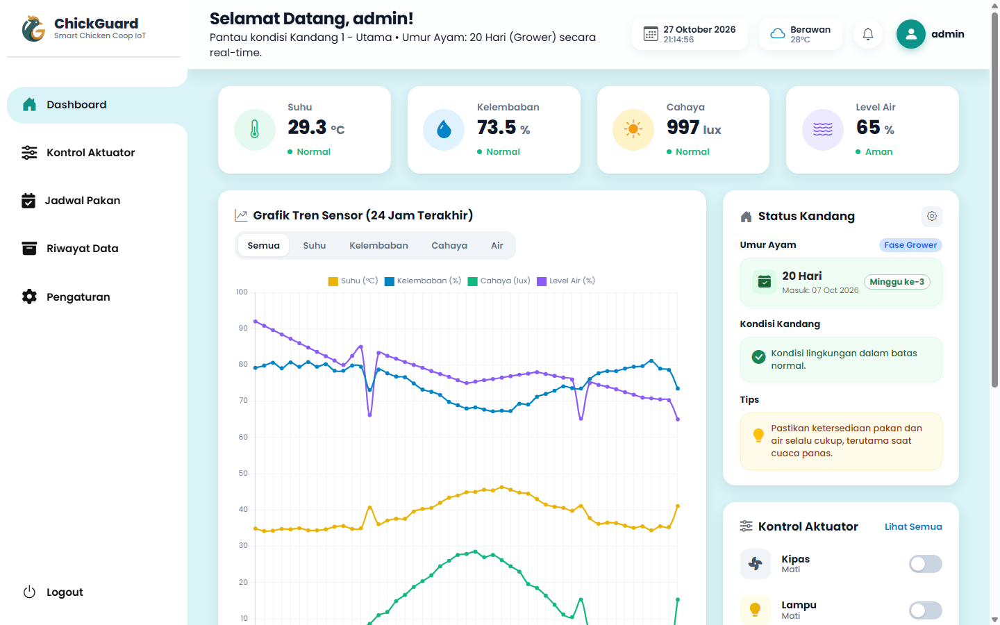
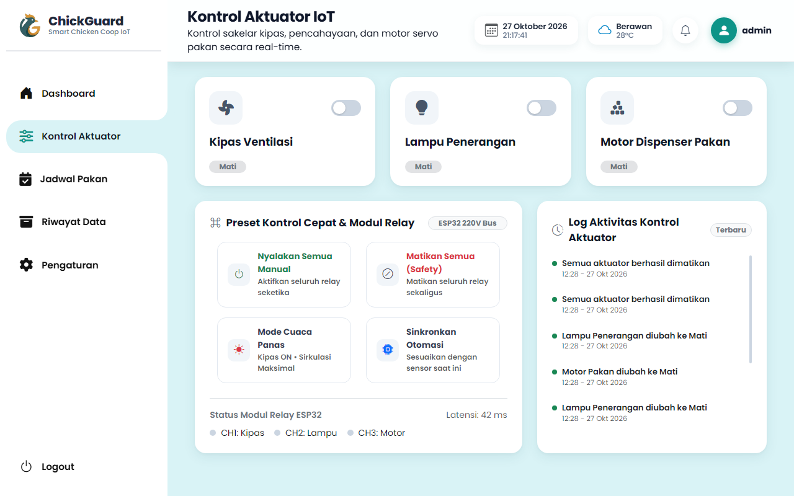
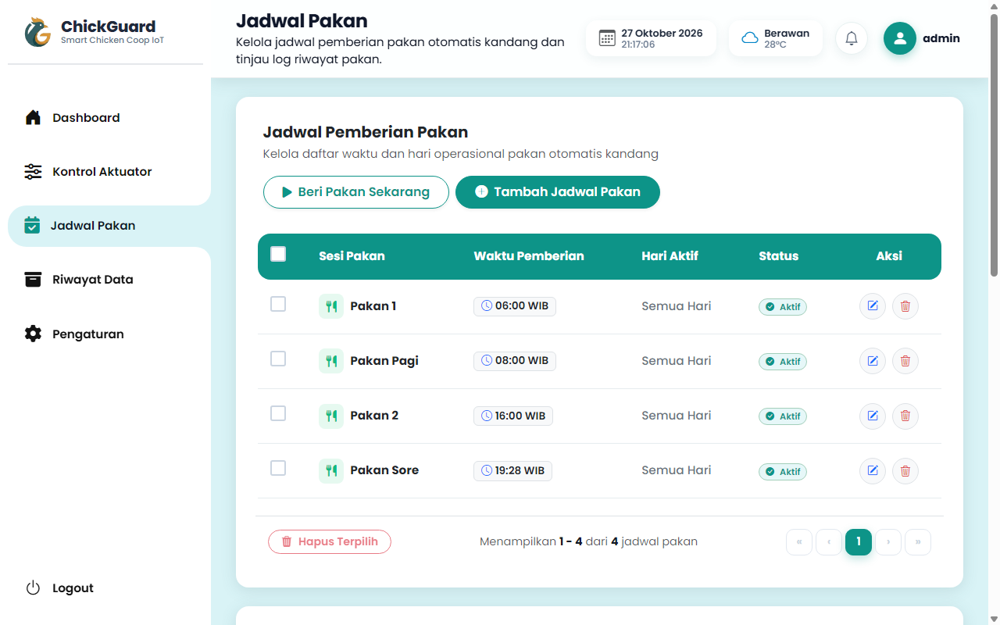
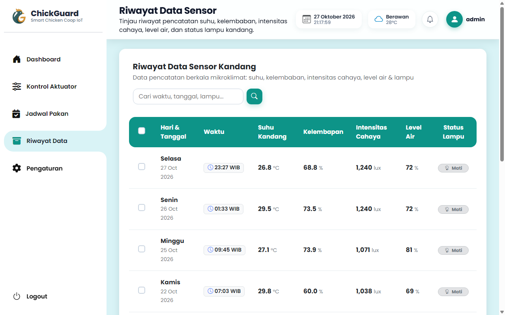
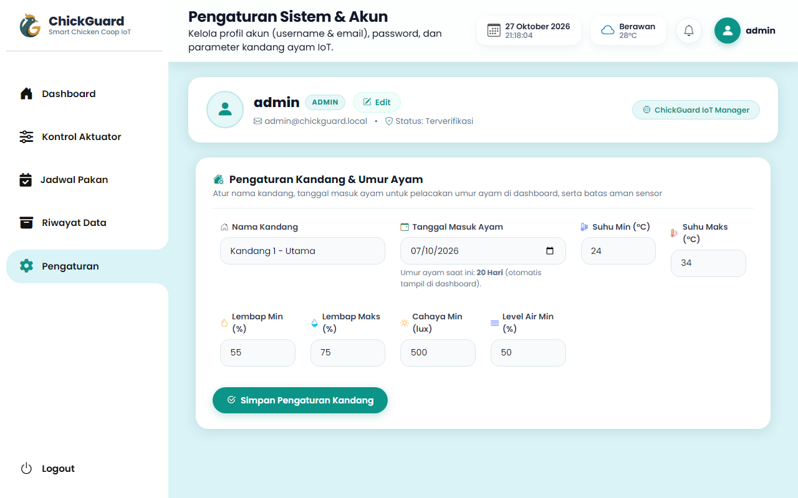
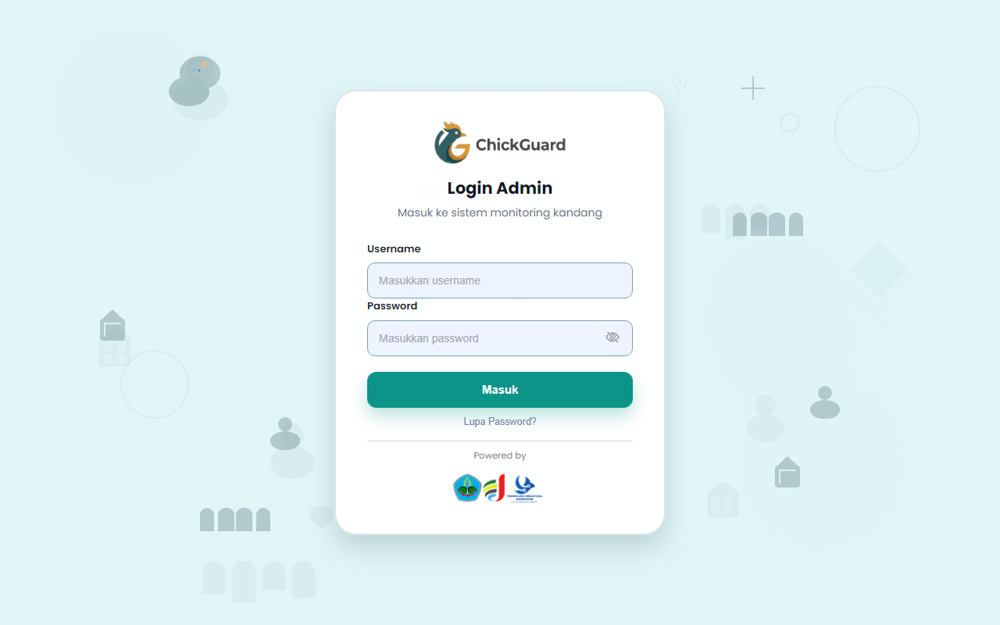

<p align="center">
  
</p>

<h1 align="center">ChickGuard &bull; Smart Chicken Coop IoT</h1>

<p align="center">
  <strong>Sistem Monitoring dan Otomasi Kandang Ayam Cerdas Berbasis Web IoT</strong><br>
  Memantau kondisi mikroklimat kandang, mengontrol aktuator secara real-time, dan mengelola jadwal pakan otomatis untuk produktivitas peternakan ayam broiler & layer yang optimal.
</p>

<p align="center">
  
  
  
  
  
</p>

---

## 📑 Daftar Isi

- [Tentang ChickGuard](#-tentang-chickguard)
- [Fitur Utama](#-fitur-utama)
- [Tangkapan Layar (Screenshots)](#-tangkapan-layar-screenshots)
- [Teknologi & Dependensi](#-teknologi--dependensi)
- [Struktur Database](#-struktur-database)
- [Struktur Folder & Berkas](#-struktur-folder--berkas)
- [Panduan Instalasi & Menjalankan](#-panduan-instalasi--menjalankan)
  - [Opsi A: Menggunakan Laragon (Direkomendasikan)](#opsi-a-menggunakan-laragon-direkomendasikan)
  - [Opsi B: Menggunakan XAMPP](#opsi-b-menggunakan-xampp)
- [Akun Pengguna Default](#-akun-pengguna-default)
- [Catatan Pengujian & Endpoint API / AJAX](#-catatan-pengujian--endpoint-api--ajax)
- [Kontributor & Lisensi](#-kontributor--lisensi)

---

## 🐣 Tentang ChickGuard

**ChickGuard** adalah aplikasi web monitoring dan manajemen kandang ayam modern yang dirancang untuk mendukung ekosistem **Internet of Things (IoT)** pada peternakan ayam. Sistem ini mempermudah peternak dalam mengawasi parameter lingkungan kandang (suhu, kelembaban, intensitas cahaya, dan ketersediaan air minum) serta mengendalikan perangkat aktuator seperti kipas ventilasi, pemanas (heater), lampu kandang, dan motor servo pakan secara manual maupun otomatis.

Aplikasi ini dilengkapi dengan algoritma pintar untuk menghitung umur ayam dan menentukan fase pemeliharaan (**Starter**, **Grower**, **Finisher**), memberikan status peringatan dinamis berdasarkan ambang batas (*threshold*), serta menampilkan grafik fluktuasi lingkungan selama 24 jam terakhir.

---

## ✨ Fitur Utama

### 1. 📊 Dashboard Monitoring Real-Time
- **Metrik Sensor Utama**: Menampilkan pembacaan terkini untuk Suhu (°C), Kelembaban (%), Intensitas Cahaya (Lux), dan Level Air Minum (%).
- **Indikator Status Cerdas**: Otomatis mendeteksi kondisi suhu/kelembaban (Normal, Dingin, Panas, Kering, atau Terlalu Lembap) sesuai ambang batas kandang.
- **Deteksi Umur & Fase Ayam**: Kalkulasi otomatis umur ayam berdasarkan tanggal masuk kandang serta penentuan fase (*Starter*: 0–7 hari, *Grower*: 8–21 hari, *Finisher*: >21 hari).
- **Rekomendasi & Tips Otomatis**: Menghasilkan tips tindakan dinamis sesuai kondisi kritis yang terdeteksi di kandang.
- **Grafik Tren 24 Jam**: Visualisasi grafik interaktif suhu dan kelembaban menggunakan **Chart.js** lengkap dengan garis batas toleransi normal.
- **Pembaruan Latar Belakang (AJAX Polling)**: Data sensor dan status diperbarui secara berkala tanpa perlu merefresh halaman.

### 2. 🎛️ Kontrol Aktuator IoT
- Sakelar kontrol digital untuk:
  - 🌀 **Kipas Ventilasi (Exhaust Fan)**
  - 🌡️ **Pemanas (Heater / Brooder)**
  - 💡 **Lampu Penerangan Kandang**
  - 🥣 **Motor Servo Dispenser Pakan**
- Respon instan berbasis AJAX (`toggle_aktuator.php`) dengan sinkronisasi ke tabel `actuator_status`.
- Indikator status visual aktif (*ON*) dan nonaktif (*OFF*).

### 3. 🕒 Manajemen Jadwal Pakan
- **Jadwal Otomatis**: Atur jam pemberian pakan, porsi takaran (kg), pengulangan hari, dan catatan khusus.
- **Tambah Cepat (Quick Add)**: Tombol pintas untuk menambahkan jadwal instan (Pagi 06:00, Siang 12:00, Sore 16:00).
- **Toggle Status Jadwal**: Mengaktifkan atau menonaktifkan jadwal pakan langsung dari daftar menggunakan sakelar interaktif.
- **Riwayat Pemberian Pakan**: Mencatat log riwayat dispenser pakan (metode otomatis/manual, status eksekusi, waktu, dan catatan).

### 4. 📜 Riwayat Data & Log Sensor
- Penyimpanan historis pembacaan data sensor kandang.
- **Pencarian Cepat**: Filter pencarian data sensor berdasarkan waktu atau nilai.
- **Paginasi Dinamis**: Dukungan pemilihan tampilan per halaman (5, 10, 20, 50 data).
- **Hapus Massal (Bulk Delete)**: Fitur pemilihan checkbox multi-data untuk penghapusan log sekaligus.

### 5. ⚙️ Pengaturan Sistem & Ambang Batas
- **Parameter Lingkungan**: Konfigurasi nama kandang, tanggal masuk ayam, serta batas bawah dan atas (*Min / Max*) untuk Suhu, Kelembaban, Cahaya, dan Level Air.
- **Profil Admin**: Pengelolaan profil pengguna (Username & Email) serta pembaruan Password yang aman menggunakan hashing Bcrypt.

### 6. 🔐 Autentikasi & Keamanan Akun
- Sistem login terproteksi berbasis sesi PHP.
- Fitur **Lupa & Reset Password** aman menggunakan token acak 64 karakter dengan batas waktu kedaluwarsa (`password_resets`).
- Hashing kata sandi modern menggunakan algoritma `PASSWORD_DEFAULT` (Bcrypt).
- Fitur shortcut pengembangan: `login_auto.php` untuk bypass sesi saat debugging di lingkungan lokal.

### 7. 🛠️ Self-Healing Auto Database Migration
- Menggunakan modul `proses/init_tables.php` yang otomatis mengecek integritas tabel, menambah kolom yang belum ada, dan mengisi data awal (*seed data*) sehingga aplikasi langsung siap digunakan tanpa error konfigurasi awal.

---

## 📸 Tangkapan Layar (Screenshots)

| Halaman Dashboard | Kontrol Aktuator |
| :---: | :---: |
|  |  |

| Jadwal Pakan | Riwayat Data Sensor |
| :---: | :---: |
|  |  |

| Pengaturan Kandang & Akun | Halaman Login Modern |
| :---: | :---: |
|  |  |

---

## 🛠️ Teknologi & Dependensi

- **Backend**: PHP 7.4 / 8.x (Native, Procedural & Prepared Statements MySQLi)
- **Database**: MySQL 5.7+ / 8.x atau MariaDB 10.x
- **Frontend**:
  - HTML5 & CSS3 Kustom (Modern Glassmorphism & Flat Dashboard UI)
  - JavaScript (Vanilla ES6, Fetch API / AJAX)
- **Libraries & Vendor Lokal**:
  - [Bootstrap 5.3](https://getbootstrap.com/)
  - [Bootstrap Icons](https://icons.getbootstrap.com/)
  - [Font Awesome 6 Free](https://fontawesome.com/)
  - [Chart.js v4](https://www.chartjs.org/)
  - Poppins Font Family (tersedia offline di `assets/vendor/poppins`)

---

## 🗄️ Struktur Database

Database default bernama **`chickguard`** terdiri dari beberapa tabel utama:

| Nama Tabel | Deskripsi Fungsi |
| :--- | :--- |
| `users` | Menyimpan data akun pengguna/admin (id, username, password hash, role, email). |
| `actuator_status` | Menyimpan status sakelar digital aktuator (kipas, heater, lampu, motor pakan). |
| `data_sensor` | Telemetri sensor real-time (suhu, kelembaban, cahaya, level air, waktu rekam). |
| `jadwal_pakan` | Konfigurasi jadwal pemberian pakan otomatis (waktu, porsi, hari aktif, catatan). |
| `log_pemberian_pakan` | Riwayat eksekusi dispenser pakan manual maupun terjadwal. |
| `log_harian` | Log agregasi riwayat sensor harian untuk pelaporan dan audit lingkungan kandang. |
| `pengaturan_kandang` | Konfigurasi batas normal lingkungan (*threshold*) dan tanggal awal masuk ayam. |
| `notifikasi` | Catatan notifikasi dan peringatan sistem bagi pengguna. |
| `password_resets` | Token reset kata sandi sementara yang aman beserta waktu kedaluwarsa. |

---

## 📁 Struktur Folder & Berkas

```text
chickguard/
├── assets/
│   ├── css/                       # Stylesheet kustom untuk setiap modul
│   │   ├── aktuator.css
│   │   ├── dashboard.css
│   │   ├── login.css
│   │   ├── log_harian.css
│   │   ├── pakan.css
│   │   ├── pengaturan.css
│   │   ├── sidebar.css
│   │   ├── style.css
│   │   └── topbar.css
│   ├── images/
│   │   ├── backgrounds/           # Wallpaper & latar belakang login
│   │   ├── branding/              # Logo, ikon, dan footer ChickGuard
│   │   └── docs/                  # Tangkapan layar dokumentasi
│   └── vendor/                    # Bootstrap, FontAwesome, ChartJS, Poppins
├── components/
│   ├── sidebar.php                # Navigasi samping bersama (shared sidebar)
│   └── topbar.php                 # Header atas & profil info bersama
├── config/
│   └── koneksi.php                # Konfigurasi koneksi MySQLi
├── database/
│   └── chickguard.sql             # Skema & dump database awal
├── pages/
│   ├── aktuator.php               # Halaman kontrol sakelar aktuator
│   ├── dashboard.php              # Halaman beranda pemantauan metrik & grafik
│   ├── log_harian.php             # Halaman riwayat tabel sensor & pencarian
│   ├── pakan.php                  # Halaman penjadwalan & log dispenser pakan
│   ├── pencahayaan.php            # Halaman konfigurasi lampu/pencahayaan
│   └── pengaturan.php             # Halaman profil & pengaturan ambang batas
├── proses/
│   ├── ambil_data_dashboard.php   # Endpoint AJAX telemetri sensor & simulasi IoT
│   ├── filter_log_harian.php      # Helper query filter pencarian & paginasi
│   ├── helpers.php                # Fungsi utilitas logika status & format waktu
│   ├── init_tables.php            # Skrip auto-migration & database seeder
│   ├── logout.php                 # Penghancur sesi & keluar sistem
│   ├── notifikasi_tandai.php      # Aksi penandaan status notifikasi
│   ├── proses_login.php           # Validasi login akun
│   ├── proses_log_harian.php      # Aksi hapus & kelola log sensor
│   ├── proses_lupa_password.php   # Pembuatan token reset password
│   ├── proses_pakan.php           # CRUD jadwal pakan & log aktivitas
│   ├── proses_reset_password.php  # Verifikasi token & ganti password baru
│   ├── simpan_pengaturan.php      # Penyimpanan ambang batas parameter kandang
│   ├── simpan_pengaturan_user.php # Pembaruan akun admin & password
│   ├── tambah_jadwal_cepat.php    # Aksi tombol quick add jadwal pakan
│   ├── toggle_aktuator.php        # Endpoint AJAX sakelar saklar aktuator
│   └── toggle_jadwal.php          # Endpoint AJAX sakelar aktifasi jadwal
├── index.php                      # Pintu masuk (redirect login / dashboard)
├── login.php                      # Halaman antarmuka login
├── login_auto.php                 # Shortcut login instan untuk pengujian lokal
├── reset_password.php             # Halaman form input password baru via token
├── tambah_admin.php               # Skrip seeder akun admin manual
├── sitemap.xml                    # Peta struktur halaman
└── README.md                      # Dokumentasi resmi proyek
```

---

## 🚀 Panduan Instalasi & Menjalankan

### Opsi A: Menggunakan Laragon (Direkomendasikan)

1. **Clone atau Salin Proyek**:
   Letakkan repositori ini di dalam direktori root Laragon:
   ```text
   C:\laragon\www\chickguard
   ```

2. **Jalankan Laragon**:
   Buka Laragon dan klik tombol **Start All** (memastikan Apache dan MySQL berjalan).

3. **Buat Database**:
   - Buka **HeidiSQL** (bawaan Laragon) atau akses `http://localhost/phpmyadmin`.
   - Buat database baru bernama: `chickguard`.
   - Import file `database/chickguard.sql`.

4. **Konfigurasi Database**:
   Periksa berkas `config/koneksi.php` (secara default sudah sesuai dengan pengaturan Laragon standar tanpa password):
   ```php
   $koneksi = mysqli_connect("localhost", "root", "", "chickguard");
   ```

5. **Akses Aplikasi**:
   Buka peramban (browser) dan kunjungi:
   - `http://chickguard.test/` atau `http://localhost/chickguard/`

---

### Opsi B: Menggunakan XAMPP

1. **Salin Folder Proyek**:
   Tempatkan folder proyek ke:
   ```text
   C:\xampp\htdocs\chickguard
   ```

2. **Jalankan Apache & MySQL**:
   Buka **XAMPP Control Panel**, kemudian jalankan modul **Apache** dan **MySQL**.

3. **Import Database**:
   - Buka peramban ke `http://localhost/phpmyadmin`.
   - Buat database baru dengan nama `chickguard`.
   - Pilih tab **Import**, lalu pilih berkas `chickguard/database/chickguard.sql`, kemudian klik **Import**.

4. **Buka Aplikasi**:
   Akses melalui browser di:
   - `http://localhost/chickguard/`

---

## 🔑 Akun Pengguna Default

Setelah database diimport, gunakan akun bawaan berikut untuk login:

| Parameter | Kredensial |
| :--- | :--- |
| **Username** | `admin` |
| **Password** | `admin123` |
| **Email** | `admin@chickguard.local` |
| **Role** | `admin` |

> 💡 **Tips Pengujian Cepat (Developer Bypass)**:  
> Anda dapat langsung mengunjungi `http://localhost/chickguard/login_auto.php` untuk login otomatis tanpa perlu mengisi formulir saat pengujian lokal.

---

## 📡 Catatan Pengujian & Endpoint API / AJAX

Sistem ini didesain agar mudah diintegrasikan dengan mikrokontroler (misalnya **ESP32 / NodeMCU ESP8266**):

- **Data Sensor**: Endpoint `proses/ambil_data_dashboard.php` menyertakan generator simulasi data sensor dinamis yang menyesuaikan siklus jam siang/malam apabila perangkat fisik IoT belum terhubung.
- **Kontrol Relay Aktuator**: Endpoint `proses/toggle_aktuator.php` menerima permintaan `POST` untuk mengubah status perangkat (`kipas`, `heater`, `lampu`, `motor_pakan`) yang dapat dibaca oleh mikrokontroler melalui polling HTTP GET/POST berkala.
- **Inisialisasi Otomatis**: Setiap kali halaman dibuka, fungsi `chickguard_init_tables()` memastikan seluruh tabel pendukung telah tersedia sehingga sistem tahan terhadap variasi versi database dump.

---

## 👨‍💻 Kontributor & Lisensi

- Dikembangkan untuk monitoring peternakan ayam berbasis teknologi IoT yang mudah diakses dan handal.
- Proyek ini dirilis di bawah lisensi terbuka untuk tujuan edukasi, penelitian, dan pengembangan agritech.